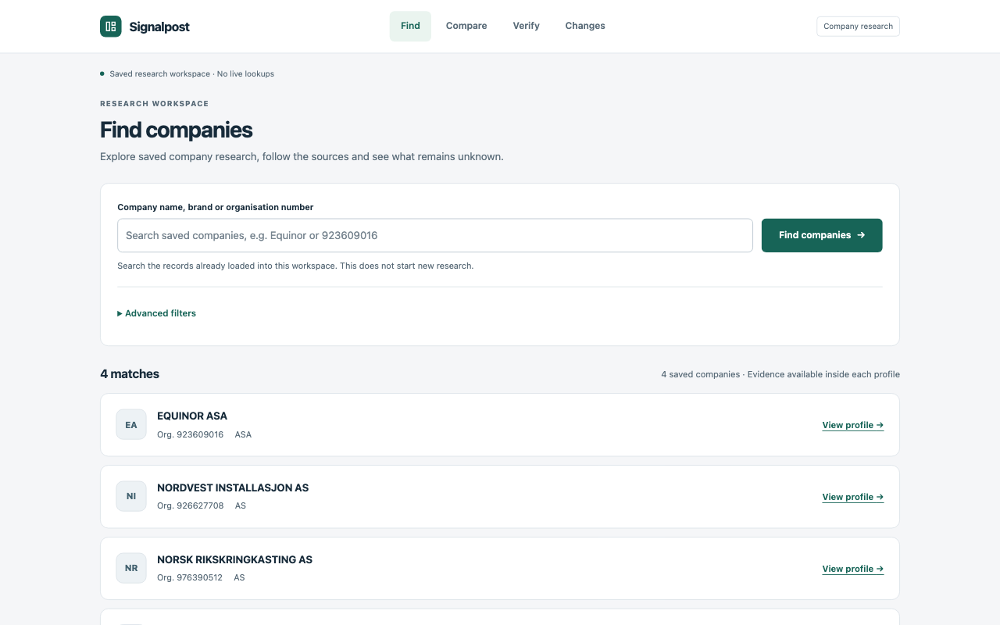
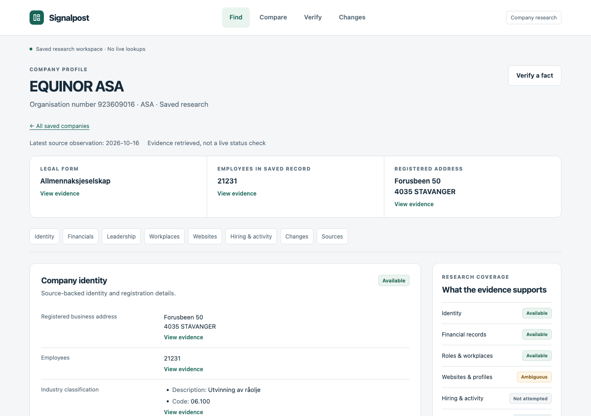
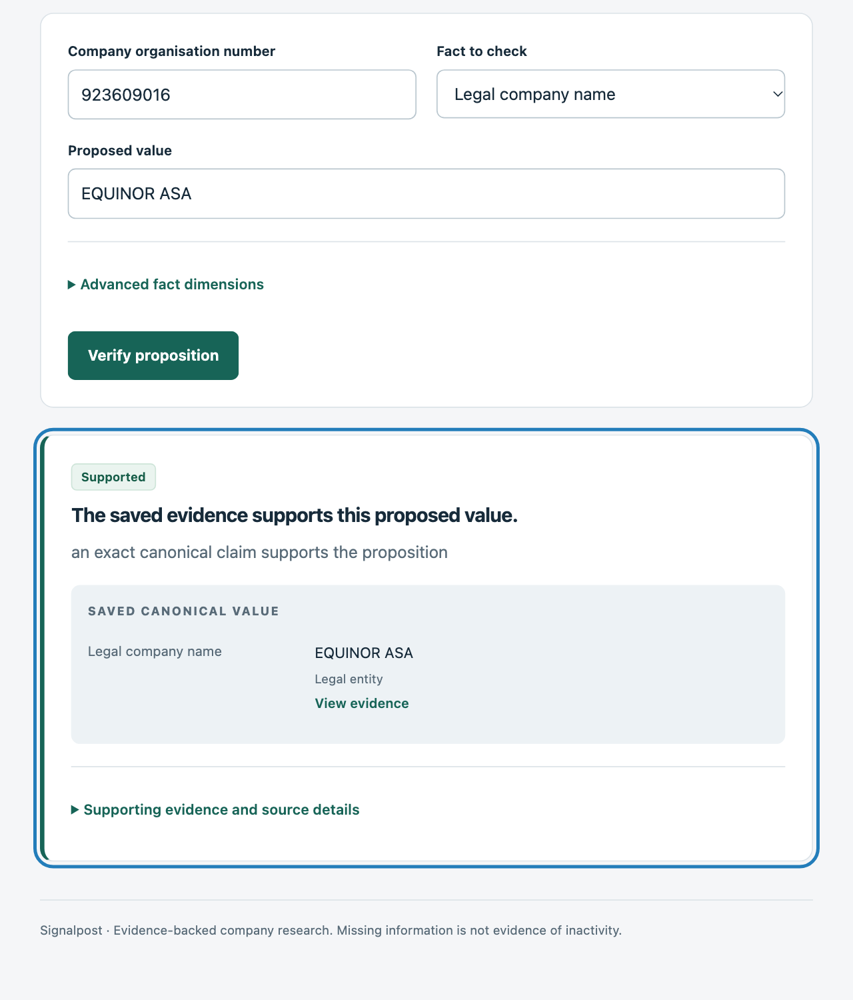
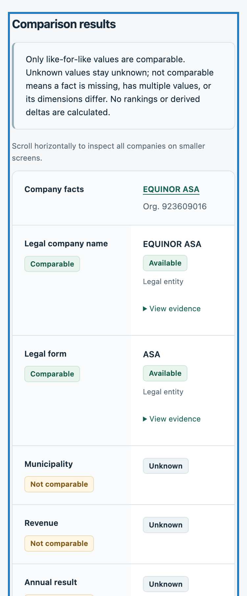
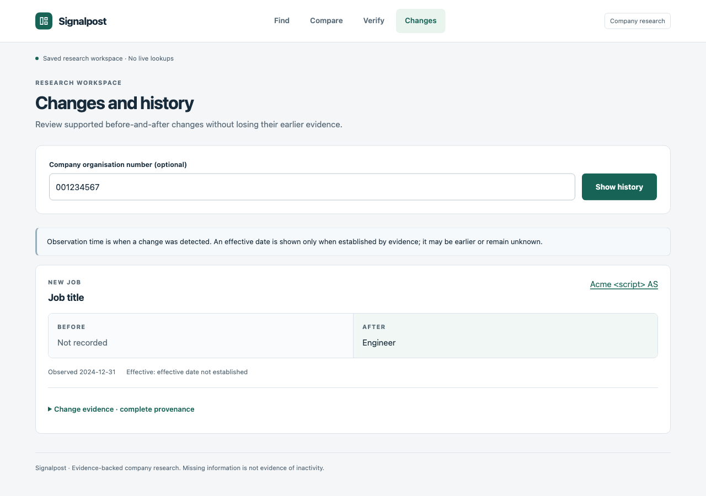

# Signalpost — product UI/UX acceptance

This presentation-only release starts from `0b0a324e6b730eee3e0ed8612b1c1ad4b0a9231c`. The deterministic research pipeline, query decisions, evaluator, ownership, financial withholding, source rights and refresh state are unchanged. The application remains server-rendered Python/FastAPI with native HTML forms and disclosures. No new dependency, external font, paid integration, credential, background research or company-data request was introduced.

## Product changes

The workspace has one light, restrained design system: shared surface, type, spacing, border, accent and state tokens; a Signalpost mark; active Find/Compare/Verify/Changes navigation; a keyboard skip link; descriptive page headers; and a persistent saved-data notice. CSS and presentation helpers are centralized in `signalpost/web_ui.py`; routes remain in `signalpost/web.py`.

Find begins with a single search field and immediate action. Advanced filters and additional AND conditions are native collapsed disclosures, with every existing field/operator/value/currency/period/scope/unit parameter preserved after submission. Only supported metadata appears in company results. Filter evidence appears when a structured predicate is applied; the misleading zero-source counter is gone for ordinary searches. Unknown predicate outcomes remain separate from verified matches. Invalid submissions retain their fields and display HTML feedback with the original HTTP error status.

Profiles begin with the supported legal name, organisation number, legal form and source observation date. A small overview shows existing legal-form, employee and address facts, each with an evidence action. There is no generated business description or invented metric. Jump links lead to identity, financials, leadership, workplaces, websites, hiring/activity, changes and sources. Long raw synthesis dumps have been replaced by this deterministic overview; the canonical synthesis engine and evaluator output are untouched.

Filings are grouped by exact resource URL, content hash and source-record path, then shown by period and scope with their record identifiers. Roles are joined only through matching source role-record paths. Group-level role metadata remains group context, never a fabricated per-person date. Workplaces use canonical subject IDs and snapshot bindings. When a safe shared binding is absent, facts remain separate and cited. Different source versions/filings are not merged just because their period and scope match. Complete fact-level evidence remains under each record; exact canonical claim values, dimensions and identifiers are inspectable on the evidence page.

Compare uses saved-company suggestions and two primary selections, with optional third/fourth selections collapsed. It preserves selections, uses legal names as headers and groups multiple values inside the correct company cell. Period/currency/scope/unit context and query-provided comparability states are retained. The comparison table has a named, keyboard-focusable horizontal scroll region on small screens. Unknown values never become zero; no ranking or derived delta is added.

Verify uses a human-readable fact selector, proposed value and collapsed dimension controls. A prominent result explains the actual query status. The canonical value is shown only for claim IDs selected by the unchanged verification query. Supporting source details are expandable, with links to complete evidence. Changes has an honest empty state and before/after event cards with observation/effective-date distinctions and retained evidence. No historical events are generated for the real-company sample.

Native form navigation jumps to submitted results. Small inline JavaScript disables the submitted button with a descriptive saved-record action and restores it on page return; it does not acquire data or simulate research progress. The UI works through ordinary form submission without JavaScript. Focus rings, native disclosures, labels, landmarks, reduced-motion support and practical mobile touch targets are included.

## Actual rendered-browser acceptance

The Chromium collaborative browser inspected initial Find, results, advanced filters, the actual populated Equinor profile, financial records, leadership, workplaces, evidence details, supported/contradicted Verify, Compare with available/missing values, empty real history, populated controlled-fixture history and invalid inputs. Browser interactions exercised search/filter submission, role disclosure and evidence navigation, company selection, supported then contradicted verification, and retained historical evidence. Keyboard Tab exposed the skip link with a visible focus ring. Mobile evidence actions measured 44 CSS pixels high.

`browser-layout.json` records 72 rendered layout measurements at 1440, 1280, 768 and 375 CSS pixels, including expanded filters/provenance/filings and expanded fixture history. No unwanted horizontal document overflow was detected. The comparison table intentionally scrolls inside its bounded region. Expected HTTP 400 responses for invalid forms are retained; their browser resource-error entries are not application JavaScript failures.

The five PNGs below are genuine browser captures. Their pixel dimensions may differ from CSS viewport dimensions because of capture scaling. The history image is **CONTROLLED SYNTHETIC FIXTURE**, on a separate loopback server using the unchanged M08 deterministic test fixture. It is not a real-company discovery and is never mixed into the four-company dashboard.

### Find — desktop

### Company profile — desktop

### Verify — tablet

### Compare — mobile

### Changes — controlled synthetic fixture only

## Evidence and functional integrity

Actual loopback profile/evidence requests checked all four original saved live records: Equinor, NRK, PARS INVEST and NORDVEST INSTALLASJON. All **908 available claim IDs** are still present in the profile disclosures, and each has company-bound evidence access. Representative evidence pages for identity, financial records, roles and workplaces returned exact source/hash/locator/snapshot metadata and raw canonical details. `data-integrity.json` contains the individual record counts, sample routes and hashes of 12 protected implementation/contract files, unchanged from the starting SHA.

The saved input bytes retain SHA-256 `57469ab6f88547812aef9ce9a357221e2a6c2c8edf6dd1e95643095fa9061602`. It has 18 account records, 44 role records and 57 workplaces. Equinor alone renders six filings, 15 roles and 35 workplaces while keeping all 397 available claims accessible. No new data was acquired; authorization usage remains 78/80 requests.

The UI tests cover collapsed/preserved filters, named comparison headers, multiple values staying in their own company cell, scoped canonical Verify results, full evidence details, empty/populated history, escaped HTML, readable invalid input and malformed source identifiers. Grouping regressions deliberately interleave role claims and use same-period distinct filings/source versions, confirming that claim order and period equality do not establish relationships. Existing M08 query and synthesis assertions remain active. Only old presentation-text assertions and smoke checks were updated for the deliberate labels and state markup.

Final full-suite and exact-SHA CI results, the clean worktree/remote check, and the restarted dashboard process are recorded in the final release receipt outside the checkout at `/home/azureuser/projects/signalpost-release-evidence/ui-ux-20261017/FINAL_UI_RECEIPT.json`. Dirty development measurements are not labeled exact-SHA CI evidence.

## Limits and next manual review

This remains a read-only dashboard over saved research, not a live research form. Native company suggestions depend on browser datalist support; exact organisation-number input always works. Long records use section links and disclosures rather than pagination. This is an accessibility-oriented browser review, not a formal screen-reader certification. Historical snapshots are metadata/evidence views, not a full document or arbitrary time-travel viewer.

The source-data coverage limits remain: no verified websites, numeric financial metrics, hiring or dated activity in this four-company sample. Account metadata availability does not establish financial metric availability. The original live refresh recorded no material change events. Saved evidence predates later extraction/role-locator repairs; its historical limitations were not rewritten or claimed repaired by this UI change.

After the final freeze the existing `signalpost-hands-on` tmux session is restarted with its original saved-data/configuration on `127.0.0.1:18082`. Refresh http://127.0.0.1:18082/ through the existing SSH tunnel. No public binding, firewall rule, public tunnel, repository visibility change, PR or external submission is authorized or performed.
